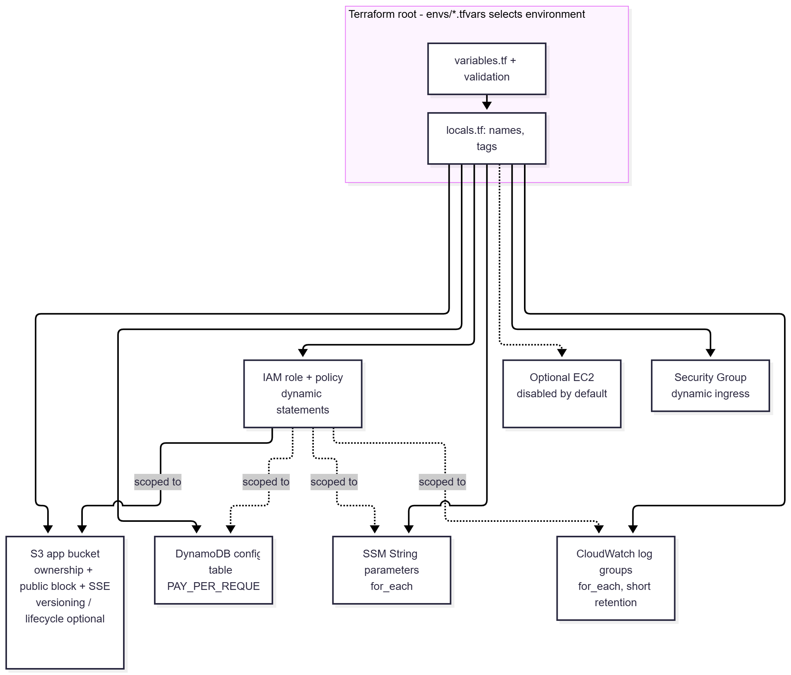
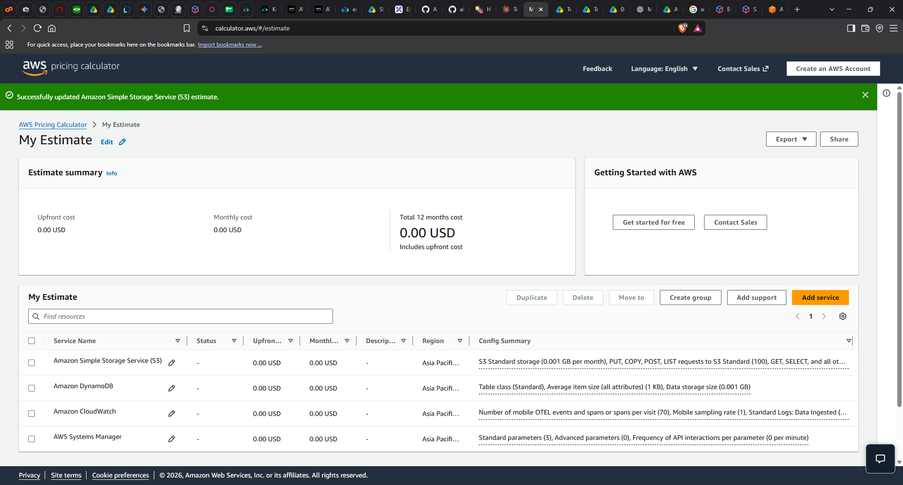

# Terraform Assignment

A single, reusable Terraform root project (no modules) that manages a small AWS stack for three environments, `dev`, `staging` and `prod`, selected only by choosing a `.tfvars` file.

- **Author:** Adnan Sarkar
- **Repository:** `https://github.com/Adnan-Sarkar/terraform-assignment.git`
- **Region:** `ap-southeast-2`

Apply `dev` only, then destroy it. `staging` and `prod` are plan-only.

---

## Table of Contents

1. [Project purpose](#1-project-purpose)
2. [Architecture overview](#2-architecture-overview)
   - [Naming convention](#naming-convention)
   - [Environment behavior](#environment-behavior)
3. [Folder structure](#3-folder-structure)
4. [AWS services used](#4-aws-services-used)
5. [Cost estimate and cost safety rules](#5-cost-estimate-and-cost-safety-rules)
6. [How to run dev](#6-how-to-run-dev)
   - [Prerequisites](#prerequisites)
   - [Steps](#steps)
7. [How to plan staging and prod](#7-how-to-plan-staging-and-prod)
8. [How to destroy dev resources](#8-how-to-destroy-dev-resources)
9. [Terraform features demonstrated](#9-terraform-features-demonstrated)
10. [Known limitations](#10-known-limitations)
11. Additional
    - [Evidence index](#additional-evidence-index)
    - [Screenshots](#additional-screenshots)
    - [Bonus features](#additional-bonus-features)
      - [Validation checks (examples)](#validation-checks-examples)
12. [Security notes](#security-notes)

---

---

## 1. Project purpose

This project is a small Terraform framework for common application infrastructure that behaves differently per environment:

- **dev** is lightweight and easy to tear down.
- **staging** is closer to production (S3 versioning on).
- **prod** is stricter and safer (versioning, `prevent_destroy`, longer retention, stricter tags and network rules).

The goals are:

1. One codebase for all environments, driven by `envs/dev.tfvars`, `envs/staging.tfvars` and `envs/prod.tfvars`.
2. No Terraform modules. Code is organized into flat files by responsibility (`s3.tf`, `dynamodb.tf`, `iam.tf` etc).
3. Computed, unique resource names (no hardcoded environment names).
4. Safe cost control: actual AWS cost stays under $5.

---

## 2. Architecture overview



The root module reads the validated variables, computes names and tags in `locals.tf`, and creates:

- an S3 application bucket (private, encrypted, optional versioning and lifecycle),
- a DynamoDB config table (on-demand),
- SSM String parameters and CloudWatch log groups (both created with `for_each`),
- a Security Group with dynamic ingress rules,
- an IAM role and least-privilege policy scoped to the resources above,
- an optional EC2 test instance that is disabled by default.

Full details, resource tables and the environment comparison are in [`docs/architecture.md`](docs/architecture.md).

### Naming convention

```text
<company>-<project>-<env-short>-<resource>-<region-short>
```

My project value contains `adnan` (`adnan-tfassign`) to keep names unique.

Example for dev: `bjit-adnan-tf-assignment-dev-app-bucket-use1`.

| Environment | env-short |
| ----------- | --------- |
| dev         | `dev`     |
| staging     | `stg`     |
| prod        | `prd`     |

All names are produced in `locals.tf` from `var.company`, `var.project`, `var.environment` and `var.aws_region`.

### Environment behavior

| Setting                           | dev           | staging        | prod                                |
| --------------------------------- | ------------- | -------------- | ----------------------------------- |
| S3 versioning                     | off           | on             | on                                  |
| Lifecycle expiration (days)       | 7             | 30             | 90                                  |
| DynamoDB / IAM / SSM / CloudWatch | on            | on             | on                                  |
| Optional EC2                      | off (default) | off (enforced) | off (enforced)                      |
| `prevent_destroy`                 | false         | false          | true                                |
| Security group ports              | 80, 443       | 80, 443        | 443 only                            |
| Log retention (days)              | 7             | 14             | 30                                  |
| Required tags                     | `Owner`       | `Owner`        | `Owner`, `Environment`, `DataClass` |

---

## 3. Folder structure

```text
terraform-assignment/
├── assets
│   ├── images
│   │       ├── 1. S3 bucket creation.png
│   │       ├── ...
├── versions.tf
├── providers.tf
├── variables.tf
├── locals.tf
├── data.tf
├── s3.tf
├── dynamodb.tf
├── iam.tf
├── ssm.tf
├── cloudwatch.tf
├── security-group.tf
├── ec2-optional.tf
├── outputs.tf
├── backend-example.tf
├── .terraform.lock.hcl
├── .gitignore
├── README.md
├── Makefile
├── .tflint.hcl
├── .pre-commit-config.yaml
├── .github/workflows/terraform.yml
├── envs/
│   ├── dev.tfvars
│   ├── staging.tfvars
│   └── prod.tfvars
├── docs/
│   ├── architecture.md
│   ├── architecture.png
│   └── cost-notes.md
└── evidence/
    ├── fmt.txt
    ├── validate.txt
    ├── plan-dev.txt
    ├── plan-staging.txt
    ├── plan-prod.txt
    ├── apply-dev.txt
    ├── output-dev.txt
    └── destroy-dev.txt
```

There is **no `modules/` directory**. Each file has one responsibility:

| File                                                                                                | Responsibility                                                 |
| --------------------------------------------------------------------------------------------------- | -------------------------------------------------------------- |
| `versions.tf`, `providers.tf`                                                                       | Terraform and provider versions, provider configuration        |
| `variables.tf`                                                                                      | All inputs with validation                                     |
| `locals.tf`                                                                                         | Short names, naming pattern, tags, computed flags              |
| `data.tf`                                                                                           | Read-only lookups (caller identity, default VPC, optional AMI) |
| `s3.tf`, `dynamodb.tf`, `iam.tf`, `ssm.tf`, `cloudwatch.tf`, `security-group.tf`, `ec2-optional.tf` | One AWS service per file                                       |
| `outputs.tf`                                                                                        | Safe outputs                                                   |
| `backend-example.tf`                                                                                | Commented remote-state design example (not active)             |

---

## 4. AWS services used

| Service                 | Used for                                 | Cost note                            |
| ----------------------- | ---------------------------------------- | ------------------------------------ |
| S3                      | Application artifact/config bucket       | Tiny storage, minimal requests       |
| DynamoDB                | Config/metadata table, `PAY_PER_REQUEST` | Pay per request, near zero when idle |
| IAM                     | Demo role and least-privilege policy     | Free                                 |
| SSM Parameter Store     | `String` parameters, Standard tier       | Free for Standard parameters         |
| CloudWatch Logs         | Log groups with short retention          | No cost without ingested logs        |
| EC2 Security Group      | Ingress rules only                       | Free                                 |
| EC2 instance (optional) | Disabled by default                      | Never enabled in this submission     |

**Not used (forbidden):** NAT Gateway, ALB, NLB, RDS, EKS, OpenSearch, Elastic IP, paid EC2 usage.

---

## 5. Cost estimate and cost safety rules

**Estimate:** effectively zero. The `dev` stack contains only free or pay-per-use resources and exists only for the few minutes between `apply` and `destroy`, with no traffic.
**Observed cost:** `$[0.00 USD]`.



More detail: [`docs/cost-notes.md`](docs/cost-notes.md).

---

## 6. How to run dev

### Prerequisites

- Terraform `>= 1.9.0` (cross-variable validation requires it)
- AWS CLI configured with credentials for the target account (credentials are **never** committed)
- A default VPC in `ap-southeast-2` (used by the security group)

Verify before running:

```bash
terraform version
aws sts get-caller-identity
```

### Steps

```bash
git clone https://github.com/Adnan-Sarkar/terraform-assignment.git
cd terraform-assignment

terraform init
terraform fmt -recursive
terraform validate

terraform plan -var-file=envs/dev.tfvars -out=dev.tfplan
terraform apply dev.tfplan
terraform output
```

Expected result: a plan of `[N]` resources to add, with names like `bjit-adnan-tf-assignment-dev-...-use1`. See `evidence/plan-dev.txt` and `evidence/apply-dev.txt`.

Using the Makefile (bonus):

```bash
make init
make fmt
make validate
make plan-dev
```

---

## 7. How to plan staging and prod

These environments are **plan-only**. Never run `apply` for them.

```bash
terraform plan -var-file=envs/staging.tfvars
terraform plan -var-file=envs/prod.tfvars
```

What to expect:

- **staging:** `aws_s3_bucket_versioning` is present, names contain `-stg-`.
- **prod:** names contain `-prd-`; the S3 bucket and DynamoDB table use the protected variants (`prevent_destroy = true`); prod tags include `DataClass` and `Environment`; the security group allows only port 443.

Evidence: `evidence/plan-staging.txt` and `evidence/plan-prod.txt`.

Makefile shortcuts: `make plan-staging`, `make plan-prod`.

---

## 8. How to destroy dev resources

```bash
terraform destroy -var-file=envs/dev.tfvars
```

Then verify in the AWS Console that the S3 bucket, DynamoDB table, IAM role and policy, SSM parameters, CloudWatch log groups and security group are gone. Evidence: `evidence/destroy-dev.txt`.

Makefile shortcut: `make destroy-dev`.

> `prod` resources are protected with `prevent_destroy`. Never destroy `prod`.

---

## 9. Terraform features demonstrated

| Feature              | Where it is used                                                                                                                       |
| -------------------- | -------------------------------------------------------------------------------------------------------------------------------------- |
| Multiple `.tfvars`   | `envs/dev.tfvars`, `envs/staging.tfvars`, `envs/prod.tfvars`                                                                           |
| Ternary conditionals | Ingress ports (`local.is_prod ? [443] : [80, 443]`), flags, `for_each` toggles, outputs                                                |
| `count`              | DynamoDB table, S3 versioning, S3 lifecycle, IAM resources, optional EC2, protected/plain bucket and table selection                   |
| `for_each`           | SSM parameters (`var.ssm_parameters`), CloudWatch log groups (`var.log_groups`)                                                        |
| Dynamic blocks       | S3 lifecycle `rule`, security group `ingress`, IAM policy `statement`                                                                  |
| `locals`             | `env_short`, `region_short`, `name_prefix`, `names`, `common_tags`, flags                                                              |
| Variable validation  | Environment, project/company naming, region, tags, versioning, EC2 flag, lifecycle days, `prevent_destroy`, log retention, CIDR blocks |
| Safe outputs         | `outputs.tf` returns `null` or empty collections when a resource is disabled                                                           |
| No modules           | Entire project is flat files in the root                                                                                               |

## 10. Known limitations

- **`prevent_destroy` cannot be a variable.** Terraform requires a literal in `lifecycle { prevent_destroy = ... }`. To keep the `prevent_destroy` variable meaningful without modules, the S3 bucket and DynamoDB table each exist as a plain resource and a protected resource; `count` selects one, and `one(concat(...))` resolves the active one. This adds some duplicated code.
- **Local state only.** There is no remote backend (it is documented in `backend-example.tf`). Do not apply multiple environments from the same working directory.
- **Default VPC dependency.** The security group uses the account's default VPC. It fails if the default VPC has been deleted.
- **Extra validation rules** beyond the assignment text (for example `prevent_destroy` must be true only in prod, minimum 30 lifecycle days in prod) make the configuration stricter than the minimum.
- **Staging and prod are plan-only**, so their real deployment behavior is verified by plan output only.
- The optional EC2 instance was never enabled or tested.

---

## Additional: Evidence index

| Evidence                   | File                        |
| -------------------------- | --------------------------- |
| `terraform fmt -recursive` | `evidence/fmt.txt`          |
| `terraform validate`       | `evidence/validate.txt`     |
| Dev plan                   | `evidence/plan-dev.txt`     |
| Staging plan               | `evidence/plan-staging.txt` |
| Prod plan                  | `evidence/plan-prod.txt`    |
| Dev apply                  | `evidence/apply-dev.txt`    |
| Dev outputs                | `evidence/output-dev.txt`   |
| Dev destroy                | `evidence/destroy-dev.txt`  |

---

## Additional: Screenshots

Screenshots of the deployed `dev` stack and the work, stored in `assets/images/`.

### 1. S3 bucket


### 2. DynamoDB


### 3. IAM


### 4. SSM


### 5. CloudWatch


### 6. Security Group


### 7. Tags


### 8. Resource Cleaning


### 9. Validation


## Additional: Bonus features

<!-- Delete any item below that you did not actually implement. -->

| Bonus                         | Implementation                                                                                                                                 |
| ----------------------------- | ---------------------------------------------------------------------------------------------------------------------------------------------- |
| Makefile                      | `Makefile` with `init`, `fmt`, `validate`, `plan-dev`, `plan-staging`, `plan-prod`, `destroy-dev`                                              |
| GitHub Actions                | `.github/workflows/terraform.yml` runs `fmt -check`, `init -backend=false` and `validate` on push and pull request (no AWS credentials needed) |
| tflint / checkov / pre-commit | `.tflint.hcl`, `.pre-commit-config.yaml`; `checkov -d . --framework terraform`                                                                 |
| Backend design                | `backend-example.tf` plus the section below                                                                                                    |

### Validation checks (examples)

These commands are expected to fail with the custom error messages, which shows the validation rules work:

```bash
terraform plan -var-file=envs/dev.tfvars -var="environment=test"
terraform plan -var-file=envs/prod.tfvars -var="enable_ec2_test_instance=true"
terraform plan -var-file=envs/prod.tfvars -var="prevent_destroy=false"
terraform plan -var-file=envs/dev.tfvars -var='project=Bad_Name'
```

---

## Security notes

- AWS credentials, `.terraform/`, `*.tfstate*` and `*.tfplan` are excluded by `.gitignore` and are not in the repository.
- `.terraform.lock.hcl` is committed to pin provider versions.
