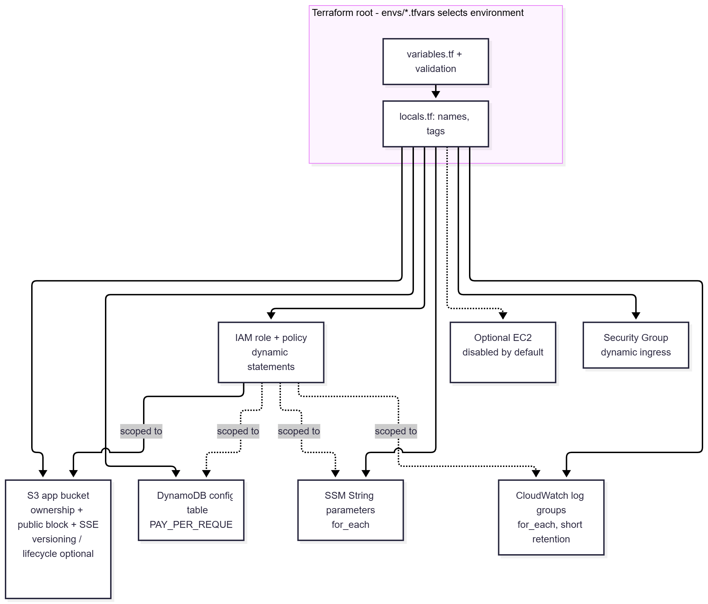

# Architecture

One flat Terraform root (no modules) creates a small AWS stack. The environment (`dev`, `staging`, `prod`) is chosen only by the `-var-file` passed to Terraform. Variables are validated, `locals.tf` computes names and tags, and each resource file reads from them.

## Diagram

Solid arrows are resources created per their enable flags. The dotted arrow to EC2 means it exists in code but is disabled by default (dev only). "scoped to" means the IAM policy grants access only to this project's own resources, never `*`.

## Components

| File                | Resources                                                                                                      |
| ------------------- | -------------------------------------------------------------------------------------------------------------- |
| `s3.tf`             | Bucket, ownership controls, public access block, encryption, optional versioning and lifecycle (dynamic block) |
| `dynamodb.tf`       | Config table, `PAY_PER_REQUEST`                                                                                |
| `ssm.tf`            | String parameters (`for_each`)                                                                                 |
| `cloudwatch.tf`     | Log groups (`for_each`)                                                                                        |
| `security-group.tf` | Security group with dynamic ingress (default VPC)                                                              |
| `iam.tf`            | Role, policy and attachment, policy built with dynamic statements                                              |
| `ec2-optional.tf`   | Optional EC2 instance (`count`), disabled by default                                                           |
| `outputs.tf`        | Safe outputs for all of the above                                                                              |

## Naming

`<company>-<project>-<env-short>-<resource>-<region-short>`, computed in `locals.tf`.

Example (dev): `bjit-adnan-tf-assignment-dev-app-bucket-apse2`.

## Environment differences

|                      | dev     | staging | prod |
| -------------------- | ------- | ------- | ---- |
| S3 versioning        | off     | on      | on   |
| Optional EC2         | off     | off     | off  |
| `prevent_destroy`    | false   | false   | true |
| Security group ports | 80, 443 | 80, 443 | 443  |

Only `dev` is applied. `staging` and `prod` are plan-only.
