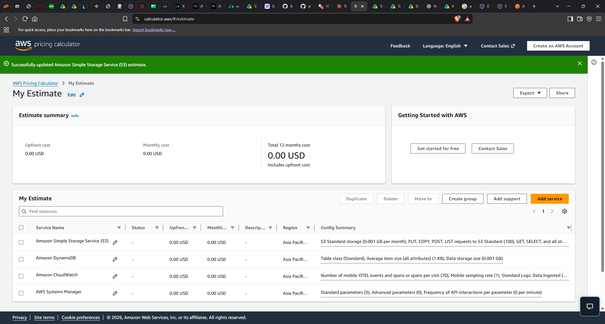

# Cost Notes

**Limit:** under $5. **Estimated cost:** about $0 (AWS Pricing Calculator shows 0.00 USD per month and for 12 months, see `cost-estimation.png`).

## Why the cost is about $0

| Service             | Why it costs almost nothing                                                              |
| ------------------- | ---------------------------------------------------------------------------------------- |
| S3                  | Billed per GB stored and per request. The bucket is empty and exists only for minutes.   |
| DynamoDB            | On-demand billing: pay per read/write. The table receives no requests and holds no data. |
| CloudWatch Logs     | Billed per GB ingested and stored. The log groups receive no logs.                       |
| SSM Parameter Store | Standard parameters have no charge (Advanced tier is never used).                        |
| IAM, Security Group | No separate charge.                                                                      |
| EC2                 | Disabled by default, never created.                                                      |

In short: nothing is billed by the hour, usage is close to zero, `dev` is destroyed right after verification, and `staging` and `prod` are plan-only so nothing is created for them.

## References

- AWS Pricing Calculator: https://calculator.aws
- S3: https://aws.amazon.com/s3/pricing/
- DynamoDB: https://aws.amazon.com/dynamodb/pricing/
- CloudWatch: https://aws.amazon.com/cloudwatch/pricing/
- Systems Manager: https://aws.amazon.com/systems-manager/pricing/
